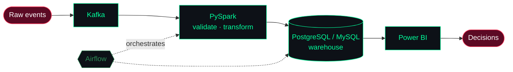

  

### 🧬 About me

- 🌱 Currently diving deeper into **Data Engineering**, **Data Science** & **Machine Learning**, with Apache Airflow and advanced data warehousing next on the list
- 💻 Tech interests: **APIs**, **SQL optimization**, **data analytics & BI**, and understanding the world of ML & AI
- 📫 Reach me at **aliraza.141@outlook.com**
- ⚡ Fun fact: **I love breaking things… so I can try to fix them better 😄**
- 🌐 Check out my [Portfolio](https://ali-raza-portfolio-eta.vercel.app/)

### 🛰️ How I think about data

### 🔌 Connect with me

  
  
  
  

### 🧰 Languages and Tools

  
  
  
  
  
  
  
  
  
  
  
  
  
  
  
  
  
  
  
  
  
  
  
  

### 📊 GitHub stats

  
  

  

  

