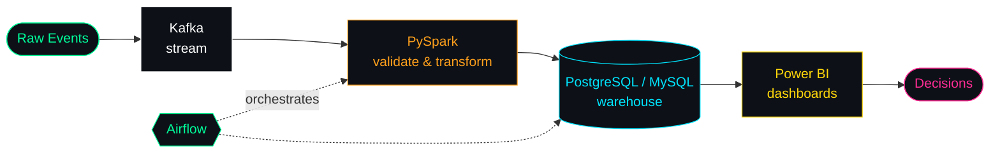

<div align="center">

<a href="https://git.io/typing-svg">
  
</a>

<br/><br/>


<br/>


</div>

<br/>

## ⚡ `whoami`

```python
class AliRaza:
    focus    = ["Data Engineering", "BI & Analytics", "Backend / Full-Stack"]
    pipeline = ["Kafka", "PySpark", "Airflow", "PostgreSQL", "Docker"]
    learning = ["Apache Airflow", "Advanced Data Warehousing", "ML & AI"]
    loves    = ["APIs", "SQL optimization", "clean data", "dashboards"]
    fun_fact = "I love breaking things... so I can fix them better 😄"
```

<br/>

## 🛰️ `how I think about data`



<br/>

## 🧰 `stack --list`

<div align="center">

<br/>


<br/><br/>

<br/>


<br/><br/>

<br/>


<br/><br/>

<br/>


</div>

<br/>

## 📊 `stats --live`

<div align="center">


<br/>


<br/>


<br/>


</div>

<br/>

## 📡 `connect --open`

<div align="center">

<a href="https://ali-raza-portfolio-eta.vercel.app/"></a>
<a href="https://www.linkedin.com/in/ali-raza-a76a9729"></a>
<a href="mailto:aliraza.141@outlook.com"></a>
<a href="https://leetcode.com/AliRaza07"></a>
<a href="https://auth.geeksforgeeks.org/user/aliraz9t6b/"></a>
<a href="https://github.com/AliRaza7x"></a>

<br/><br/>


</div>


